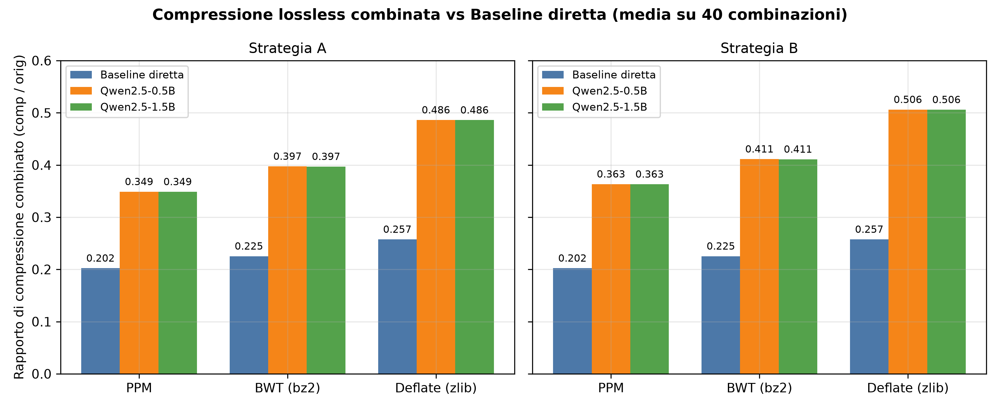

# Progressive Neural Compression with Lossless Residuals


Pipeline sperimentale e riproducibile per la **compressione neurale progressiva di testo italiano con residui lossless**, sviluppata per il corso di *Compressione Dati* (Università degli Studi di Salerno).

L'idea di base combina l'elisione controllata di parole, la ricostruzione tramite modelli linguistici locali leggeri (LLM) e la codifica lossless dei soli errori residui all'interno di un container binario verificato bit-a-bit (`gapcomp/1`).

---

## Come funziona la pipeline

Il sistema implementa uno schema completo **Encoder → Container → Decoder** che garantisce la ricostruzione identica al testo originale (verifica `SHA-256` bit-a-bit) senza mai includere l'oracle nel payload trasmesso:

1. **Elisione controllata (Fase 2–4):** dato un testo originale, vengono generati deterministicamente uno **scheletro** (testo con parole rimosse), un **manifest** (coordinate strutturali dei gap, privo di oracle) e un **oracle** (parole rimosse, usato solo lato encoder e per la valutazione).
2. **Inferenza neurale (Fase 5):** un LLM locale riceve esclusivamente lo scheletro (elaborato per chunk con greedy decoding deterministico) e predice le parole mancanti.
3. **Calcolo dei residui e impacchettamento (Fase 6 — Encoder):** confrontando la predizione del modello con l'oracle si genera lo stream compatto `corrections` (`=` in caso di exact match, `+testo` solo in caso di errore). I tre stream congelati (`skeleton`, `manifest_or_placeholder`, `corrections`) vengono compressi separatamente con `deflate`, `bwt` e `ppm` nel container binario **`gapcomp/1`**.
4. **Decompressione e verifica lossless (Fase 6 — Decoder):** il decoder apre il container `.gapcomp`, verifica gli `SHA-256` di tutti gli stream, combina scheletro, predizioni del modello e residui (senza accedere all'oracle) e verifica che il testo ricostruito sia identico bit-a-bit all'originale.
5. **Valutazione e controlli (Fase 7):** calcolo delle metriche di fedeltà (`sacrebleu`, `ROUGE-L`, `Precision@k`), classificazione deterministica degli errori via LCS (`deterministic_subsequence`), controlli sperimentali (`context_density`, `elided_composition`) e generazione dei grafici comparativi a 300 DPI.

### Strategie sperimentali confrontate

| Strategia | Descrizione | Segnaposto nello scheletro | Informazione visibile al modello |
| :--- | :--- | :---: | :--- |
| **Strategia A** | Elisione pura + manifest | Nessuno | Il modello deve individuare dove mancano parole e inferirle |
| **Strategia B** | Elisione con segnaposto atomici + manifest | `[N]` | Il modello vede esattamente la posizione e il numero `N` di parole rimosse |

Ogni strategia viene testata su **5 rapporti di elisione** (`10%`, `20%`, `30%`, `40%`, `50%`) × **4 condizioni di selezione lessicale** definite in `config/elision.yaml` = **40 combinazioni per documento e modello**.

---

## Stato di avanzamento

| Fase | Obiettivo | Stato | Output / Verifica |
| :--- | :--- | :---: | :--- |
| **Fase 0** | Setup repository, ambiente Python 3.12, gestione dipendenze | ✅ Completata | Venv isolato, `.gitignore`, struttura progetto |
| **Fase 1** | Definizione e congelamento del **Protocollo v1.1** | ✅ Completata | `config/*.yaml` + 11 test di coerenza |
| **Fase 2** | Motore di elisione deterministico (`elision/`) | ✅ Completata | Tokenizer reversibile, segnaposto `[N]` atomici, 5 test unitari |
| **Fase 3** | Preparazione corpora e split (`data/dev/`) con verifica hash | ✅ Completata | 30 documenti sincronizzati via hash tra macOS e Linux |
| **Fase 4** | Generazione scheletri, manifest e oracle (`run_phase2.py`) | ✅ Completata | 160 file generati per `finewiki_it_small_001` (40 combo × 4 file) |
| **Fase 5** | Inferenza LLM deterministica (`inference/`, `run_phase5.py`) | ✅ Completata | `model_1` (`0.5B`): **40/40 OK** — `model_2` (`1.5B`): **40/40 OK** |
| **Fase 6** | Residui lossless, codec `deflate`/`bwt`/`ppm`, container `gapcomp/1` | ✅ Completata | **240/240 verifiche lossless OK** (120+120), 3 test unitari |
| **Fase 7** | Metriche di fedeltà (`BLEU`, `ROUGE-L`, `P@k`), errori, controlli e grafici | ✅ Completata | `evaluation/`, 4 test unitari (**23/23 pytest**), 4 grafici 300 DPI |

---

## Struttura del repository

```text
.
├── config/                  # Configurazioni congelate del Protocollo v1.1
│   ├── base.yaml            # Path, seed globale (42), split e scale
│   ├── elision.yaml         # Strategie A/B, ratio 10%-50%, 4 condizioni lessicali
│   ├── inference.yaml       # Modelli (0.5B / 1.5B), revisioni pinned, decoding greedy
│   └── metrics.yaml         # Formule congelate (fidelity, errors, compression, controls)
├── elision/                 # Fase 2: tokenizzazione reversibile ed elisione deterministica
│   ├── tokenizer.py         # Tokenizzazione esatta + gestione atomica di [N]
│   ├── seed.py              # Derivazione SHA-256 deterministica del seed
│   ├── word_selection.py    # Classificazione anchor / content / function words
│   └── generator.py         # Generazione skeleton, manifest (no-oracle) e oracle
├── inference/               # Fase 5: inferenza chunked con modelli locali
│   ├── prompts.py           # Template zero-shot puliti per Strategia A e B
│   └── runner.py            # Loader, greedy decoding, prompt lookup e allineamento gap
├── compression/             # Fase 6: compressione e ricostruzione lossless
│   ├── codecs.py            # Wrapper deflate (zlib-9), bwt (bz2-9), ppm (pyppmd)
│   ├── residuals.py         # Codifica/decodifica residui (= / +testo) e ricostruzione A/B
│   └── container.py         # Formato binario gapcomp/1 + verifiche SHA-256 e anti-oracle
├── evaluation/              # Fase 7: valutazione fedeltà, errori e controlli di protocollo
│   ├── fidelity.py          # sacreBLEU, ROUGE-L e Precision@k (k=1,3,5,10)
│   ├── errors.py            # Allineamento deterministico LCS e tassi di errore
│   └── controls.py          # context_density (±50 parole) e elided_composition
├── experiments/             # Script eseguibili della pipeline
│   ├── run_phase2.py        # Generazione dei 40 scheletri + manifest + oracle
│   ├── run_phase5.py        # Esecuzione inferenza per modello (--model, --tags)
│   ├── run_phase6.py        # Compressione 3 stream, container .gapcomp e verifica lossless
│   ├── run_phase7.py        # Calcolo metriche di qualità, errori e controlli
│   └── plot_phase7.py       # Generazione dei 4 grafici comparativi a 300 DPI
├── tests/                   # Suite di test unitari (pytest: 23/23 passed)
│   ├── test_config_consistency.py
│   ├── test_fase2.py
│   ├── test_fase6.py
│   └── test_fase7.py
└── logs/                    # Hash di riferimento dei commit per tracciabilità delle fasi
```

> **Nota su Git:** i documenti sorgenti (`data/`) e gli output pesanti (`experiments/outputs/phase5/`, container binari `.gapcomp`) sono esclusi da `.gitignore` per mantenere il repository leggero; le tabelle aggregate (`summary.csv`, `combined_summary.csv`) e i grafici finali (`experiments/outputs/phase7/figures/`) sono tracciati nel repository per ispezione immediata.

---

## Setup e installazione

### macOS (Apple Silicon)

```bash
git clone [https://github.com/ClaudioMarotta05/Progressive-Neural-Compression-with-Loseless-Residuals.git](https://github.com/ClaudioMarotta05/Progressive-Neural-Compression-with-Loseless-Residuals.git)
cd Progressive-Neural-Compression-with-Loseless-Residuals

python3.12 -m venv ~/venvs/gap-compression
source ~/venvs/gap-compression/bin/activate
pip install --upgrade pip
pip install -r requirements.txt
pip install matplotlib
```

### Linux (CPU o GPU NVIDIA CUDA)

```bash
git clone [https://github.com/ClaudioMarotta05/Progressive-Neural-Compression-with-Loseless-Residuals.git](https://github.com/ClaudioMarotta05/Progressive-Neural-Compression-with-Loseless-Residuals.git)
cd Progressive-Neural-Compression-with-Loseless-Residuals

python3.12 -m venv .venv
source .venv/bin/activate
pip install --upgrade pip
pip install -r requirements.txt
pip install matplotlib
```

---

## Esecuzione passo-passo

### 1. Verifica dei test unitari

```bash
python -m pytest tests/ -v
```

Output atteso: **`23 passed`** (coerenza configurazioni, determinismo elisione, codec, residui, container `gapcomp/1`, controllo anti-oracle, metriche di fedeltà, errori LCS e controlli).

### 2. Fase 4 — Generazione di scheletri, manifest e oracle

```bash
python experiments/run_phase2.py
```

Genera le 40 combinazioni in `experiments/outputs/phase2/finewiki_it_small_001/`.

### 3. Fase 5 — Inferenza neurale

Modelli configurati in `config/inference.yaml`:
- **`model_1`:** `Qwen/Qwen2.5-0.5B-Instruct` (revisione bloccata `7ae557604adf67be50417f59c2c2f167def9a775`)
- **`model_2`:** `Qwen/Qwen2.5-1.5B-Instruct`

Su **macOS** (usa `caffeinate -i` per evitare lo sleep durante le esecuzioni lunghe):

```bash
caffeinate -i python experiments/run_phase5.py --model model_1
caffeinate -i python experiments/run_phase5.py --model model_2
```

Su **Linux** (rileva automaticamente CUDA se disponibile):

```bash
python experiments/run_phase5.py --model model_2
```

Lo script è **riprendibile**: se interrotto con `Ctrl+C`, al riavvio salta automaticamente le combinazioni già salvate. È anche possibile eseguire una singola combinazione di test con `--tags A_10_anchor_preservation`.

### 4. Fase 6 — Compressione lossless e verifica bit-a-bit

```bash
python experiments/run_phase6.py --model all
```

Produce per ciascun modello (`model_1` e `model_2`):
- `experiments/outputs/phase6/<model_id>/containers/*.gapcomp` (120 container binari per modello)
- `experiments/outputs/phase6/<model_id>/reports/*.json` (40 report dettagliati per combinazione)
- `experiments/outputs/phase6/<model_id>/summary.csv` (tabella aggregata per l'analisi)

### 5. Fase 7 — Valutazione qualità, controlli e grafici

```bash
python experiments/run_phase7.py --model all
python experiments/plot_phase7.py
```

Produce:
- `experiments/outputs/phase7/<model_id>/reports/*.json` e `summary.csv`
- `experiments/outputs/phase7/combined_summary.csv` (tabella unificata `model_1` + `model_2`)
- `experiments/outputs/phase7/figures/*.png` (4 grafici in italiano a 300 DPI)

---

## Scelte tecniche e ottimizzazioni (Fase 5)

Durante il collaudo e l'esecuzione completa su **MacBook Air M4** sono emersi e stati risolti alcuni aspetti chiave documentati nel codice:

- **CPU `float32` preferita a MPS su Apple Silicon:** il backend `mps` in `float16` ha mostrato instabilità numerica e decadimento dell'output; `cpu` in `float32` garantisce stabilità completa.
- **Accelerazione lossless dell'inferenza (`prompt_lookup_num_tokens=10`):** sfruttando il fatto che lo scheletro va in gran parte ricopiato fedelmente, il prompt-lookup decoding di Hugging Face mantiene l'esatto output del greedy decoding (`do_sample=False`, `num_beams=1`), rendendo gestibili le esecuzioni locali sia per `model_1` (~3,5 ore totali) sia per `model_2` (~12–13 ore totali).
- **Chunking deterministico:** lo scheletro viene elaborato in chunk da ~200 parole per evitare saturazione di contesto e troncamenti, poi ricomposto nell'ordine originale.
- **Prompt zero-shot puliti:** i test con prompt 1-shot su modelli compatti causavano copia dell'esempio o deriva testuale; i template zero-shot in `inference/prompts.py` preservano la fedeltà allo scheletro.
- **Determinismo cross-hardware:** la ricostruzione lossless richiede che encoder e decoder ottengano la medesima predizione $\hat{Y}$. Differenze di backend o precisione (es. `cpu/float32` su ARM64 vs `cuda/float16` su x86_64) possono produrre divergenze sui logit in virgola mobile; pertanto ogni modello completa il ciclo compressione → decompressione sullo stesso ambiente hardware.

---

## Risultati — Fase 6 (`model_1` `0.5B` vs `model_2` `1.5B`)

Documento di riferimento: **`finewiki_it_small_001`** (`117.304` byte grezzi).

### Baseline di compressione diretta sul testo originale

| Codec | Byte compressi | Rapporto (`comp / orig`) | Verifica lossless |
| :--- | :---: | :---: | :---: |
| `deflate` (`zlib`, level 9) | 30.201 B | `0.257` | ✅ OK |
| `bwt` (`bz2`, level 9) | 26.426 B | `0.225` | ✅ OK |
| `ppm` (`pyppmd`) | 23.722 B | `0.202` | ✅ OK |

### Confronto diretto della pipeline neurale + residui (medie su 40 combinazioni per modello)

| Strategia | Codec | Hit% `0.5B` | Hit% `1.5B` | `ratio_combined` `0.5B` | `ratio_combined` `1.5B` | `vs_baseline` `1.5B` | Overhead Manifest | Lossless (240/240) |
| :---: | :--- | :---: | :---: | :---: | :---: | :---: | :---: | :---: |
| **A** | `ppm` | 0.33% | **3.31%** | 0.3488 | **0.3487** | `1.724x` | 596.49% | ✅ OK |
| **A** | `bwt` | 0.33% | **3.31%** | 0.3973 | **0.3970** | `1.762x` | 596.49% | ✅ OK |
| **A** | `deflate` | 0.33% | **3.31%** | 0.4862 | **0.4860** | `1.888x` | 596.49% | ✅ OK |
| **B** | `ppm` | 0.41% | **3.06%** | 0.3634 | **0.3632** | `1.796x` | 560.04% | ✅ OK |
| **B** | `bwt` | 0.41% | **3.06%** | 0.4113 | **0.4110** | `1.824x` | 560.04% | ✅ OK |
| **B** | `deflate` | 0.41% | **3.06%** | 0.5061 | **0.5059** | `1.965x` | 560.04% | ✅ OK |



---

## Risultati — Fase 7 (Fedeltà, Errori e Controlli del Protocollo v1.1)

### Metriche di fedeltà e profilazione errori (medie su 40 combinazioni per modello)

| Modello | `sacreBLEU` aggregato | Strategia | `BLEU` medio | `ROUGE-L` (F1) | Token Acc. (LCS) | Exact Gap% (token) | Allucinazioni | Omissioni | `P@10` | `CtxDensity` |
| :--- | :---: | :---: | :---: | :---: | :---: | :---: | :---: | :---: | :---: | :---: |
| **`model_1` (`0.5B`)** | `24.27` | **A** | 23.19 | 0.5311 | 0.71% | 0.39% | 98.67% | 99.
